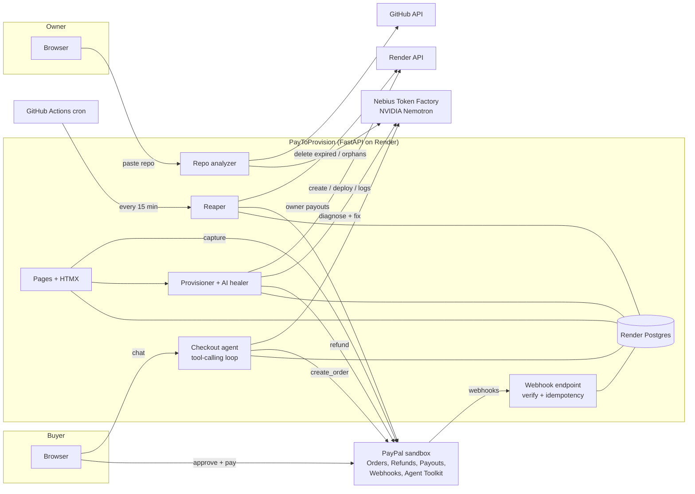
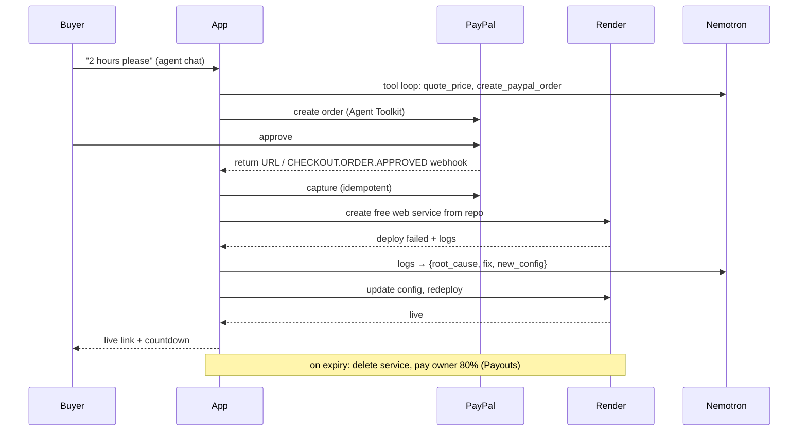

# PayToProvision

[](https://github.com/jaydeep-99o/paytoprovision/actions/workflows/ci.yml)
[](LICENSE)

**Turn any GitHub repo into a paid live demo.**

A repo owner pastes a GitHub link and sets an hourly price. **AI reads the repo** and works out how to deploy
it. A buyer chats with an **AI checkout agent** ("I want to try this for 2 hours"); the agent quotes a price and
creates a **PayPal order with the PayPal Agent Toolkit**. After payment, the app is **deployed on Render**
through the Render API and the buyer gets a private live link with a countdown. If the deploy fails, **AI reads
the logs, fixes the config and retries**; if it still can't, the buyer is **refunded automatically**. When time
is up the environment is deleted and the owner is **paid out via PayPal Payouts** (minus a 20% platform fee).

> **Live demo:** https://paytoprovision.onrender.com · PayPal **sandbox only**, no real money moves.
> Built for the PayPal AI Hackathon (bonus tracks: Agentic Commerce, Best Use of Render).

## Try it (judges)

1. Open https://paytoprovision.onrender.com and pick a demo, or go straight to a listing.
2. **Agentic checkout:** in the *Checkout agent* chat, ask "What does this app do?", then
   "I'd like to try it for 1 hour". Confirm, and click **Pay with PayPal** under the agent's message.
   Or use the regular PayPal buttons on the right.
3. Log in with a **PayPal sandbox personal account** (see the Devpost testing instructions for one).
4. You land on your session page: payment captured → building → starting → **Live** with a link and countdown.
5. Try the broken demos to see the AI at work:
   - **Weather Now** (`ptp-demo-heal-python`) crashes at boot (`ModuleNotFoundError: requests`). The AI
     diagnoses it, adds the package to the build command and redeploys: live in about 2.5 minutes.
   - **Invoice Studio** (`ptp-demo-never-builds`) depends on a private package. The AI explains it can't be
     fixed without code changes and the payment is **refunded automatically** within ~30 seconds.
6. **As an owner:** *List your repo* → **Sign in with GitHub** and pick one of your repos (or paste any public
   GitHub link) → see the AI's deploy plan (confidence,
   port fix, env vars, files it read) → set a price and publish. The *Dashboard* shows sessions, earnings and payouts.
   Repos outside the allowlist can be analyzed but need admin approval before buyers see them.

The free Render instance sleeps after 15 idle minutes: the first visit can take about a minute.

## Architecture



**Session lifecycle:** `pending_payment → paid → deploying ⇄ healing → live → expired`, or `→ failed_refunded`.
Transitions are enforced in code ([app/models.py](app/models.py)).



## How PayPal is used

| Feature | Where |
|---|---|
| **Orders v2** create + capture (server-side, idempotent `PayPal-Request-Id`) | [app/payments/paypal.py](app/payments/paypal.py), [app/checkout.py](app/checkout.py) |
| **JS SDK buttons** (PayPal + card) on the listing page | [app/templates/listing.html](app/templates/listing.html) |
| **PayPal Agent Toolkit** (`create_order`, `get_order_details`) for the checkout agent | [app/payments/toolkit.py](app/payments/toolkit.py), [app/ai/agent.py](app/ai/agent.py) |
| **Webhooks** with signature verification (`verify-webhook-signature`) and idempotency (stored event IDs) | [app/routes/webhooks.py](app/routes/webhooks.py) |
| **Refunds** automatically when a deploy can't be fixed | [app/provisioner.py](app/provisioner.py) |
| **Payouts** to the repo owner (80%) when a session ends | [app/payouts.py](app/payouts.py) |

Capture never relies only on webhooks: the browser captures right after approval, the return URL captures for
approval links, and `CHECKOUT.ORDER.APPROVED` covers a buyer who closed the tab. All three funnel into one
idempotent function. Capacity (max 3 live previews) is checked *before* money is taken.

## How AI is used

All AI runs on **Nebius Token Factory** with **NVIDIA Nemotron 3 Super** (`nvidia/nemotron-3-super-120b-a12b`,
OpenAI-compatible API). Every structured answer is strict JSON, validated with Pydantic, and retried once with the
validation error fed back. Repo content and logs are treated as untrusted data (prompt-injection guard).

1. **Repo analyzer** ([app/ai/analyzer.py](app/ai/analyzer.py)): reads README, manifests and entry files via
   the GitHub API and returns runtime, build/start commands, port notes, env vars, health path, confidence and a
   buyer-facing summary. Deterministic guardrails then force Python servers to bind `$PORT`, drop `PORT` from env
   vars, and fill sane defaults. Every change is shown to the owner.
2. **Self-healing deployer** ([app/ai/healer.py](app/ai/healer.py), [app/provisioner.py](app/provisioner.py)):
   on a failed deploy it reads build + app logs and returns `{root_cause, fix_explanation, fixable, new_config}`.
   It may only change the build/start command, env vars and health path. Fixes that write files, download and
   run scripts, clone other repos or change nothing are rejected. Max 2 fixes, then an automatic refund. A deploy
   stuck "starting" on a failing health check is cancelled after 4 minutes instead of Render's ~15.
3. **Checkout agent** ([app/ai/agent.py](app/ai/agent.py)): a manual tool-calling loop with
   `get_listing_details`, `quote_price`, `create_paypal_order` and `check_order_status`. The model never sets prices
   (tools take only `hours`; the server computes the amount), can only check orders for this listing, and can't
   pay: it hands the buyer an approval link.

**Why a manual tool loop with the Agent Toolkit's core?** The toolkit's framework adapters (OpenAI Agents SDK,
CrewAI, LangChain) pull in heavy dependencies that don't fit a 512 MB instance, while its core `PayPalAPI.run`
is framework-agnostic. So orders are created by the toolkit's own `create_order` tool, and the loop around it is
~100 lines on the Nemotron chat API.

## How Render is used

- **The app:** a Render web service + Render Postgres from a Blueprint ([render.yaml](render.yaml)); the same stack
  as Terraform with the official provider ([infra/terraform](infra/terraform)).
- **Preview environments:** each paid session creates a free web service through the Render REST API
  ([app/render_client.py](app/render_client.py)), streams deploy status to the buyer, reads build/app logs for
  the AI, updates config and redeploys, and deletes it on expiry.
- **Reaper** ([app/reaper.py](app/reaper.py)): every 15 minutes from a GitHub Actions cron
  ([.github/workflows/reaper.yml](.github/workflows/reaper.yml)) and after app traffic. It deletes expired
  previews, resumes deploys interrupted by a restart, retries refunds, pays owners, and removes orphan services
  (only with the `ptp-` prefix, only older than 30 minutes).

## Sign in with GitHub

Owners can sign in with a GitHub OAuth App to pick a repo from their own list instead of pasting a link, and to
manage their listings from any device ([app/auth.py](app/auth.py), [app/routes/auth.py](app/routes/auth.py)).

- **No OAuth scopes.** The token can only read the public profile; it's used once in the callback and discarded.
  The repo list comes from GitHub's public API with the server's own token.
- CSRF `state` in a 10-minute signed cookie; the session cookie is HMAC-SHA256 signed, HttpOnly, SameSite=Lax and
  Secure in production. `next=` only accepts local paths.
- Listings follow the account: the first sign-in adopts the browser's listings, a sign-in on another device merges
  that device's listings in. Signing out rotates the browser's owner key.
- Optional: without `GITHUB_CLIENT_ID`/`GITHUB_CLIENT_SECRET` the sign-in button is hidden and pasting a link works
  as before.

## CI/CD

[.github/workflows/ci.yml](.github/workflows/ci.yml) runs on every push and pull request:

1. **test**: ruff lint and format check, `alembic upgrade head` + `alembic check` (models and migrations agree),
   pytest.
2. **terraform**: `fmt -check`, `init -backend=false`, `validate` for [infra/terraform](infra/terraform).
3. **deploy** (pushes to `main` only, after both pass): [scripts/deploy.py](scripts/deploy.py) asks the Render API
   to deploy *exactly that commit*, waits for it to go live (on failure it prints the build and app logs into the
   job summary and fails the run), then **smoke-tests production**: `/healthz` must report the new commit and the
   key pages must return 200.

Render's own auto-deploy is off (`autoDeployTrigger: "off"` in [render.yaml](render.yaml)), so nothing reaches
production without a green pipeline. Deploys share one concurrency group and never cancel each other mid-flight.
Secrets needed in the repo (Settings → Secrets and variables → Actions): `RENDER_API_KEY`, `RENDER_OWNER_ID`.

## Guardrails

Allowlisted repos only go live without admin approval (`ALLOWED_REPOS`) · max 3 concurrent previews · max 2 hours
per session · preview services prefixed `ptp-` · **global daily budgets for AI calls and deploys**
(`AI_DAILY_CALL_LIMIT`, `DEPLOY_DAILY_LIMIT`) so credit can't be drained · analysis, chat and orders rate-limited
per IP · security headers (CSP frame-ancestors, nosniff, referrer policy) · secrets only in env vars (`SecretStr`,
never logged) · sandbox-only PayPal.

## Run locally

```bash
python -m venv .venv
.venv/Scripts/activate          # Windows; use `source .venv/bin/activate` on macOS/Linux
pip install -r requirements-dev.txt
pip install --no-deps paypal-agent-toolkit==1.11.0
cp .env.example .env            # fill in what you have; empty values use defaults
alembic upgrade head            # SQLite (ptp-dev.db) unless DATABASE_URL is set
uvicorn app.main:app --reload   # http://localhost:8000
```

Use `PREVIEW_NAME_PREFIX=ptp-dev-` locally (the default in `.env.example`) so a local reaper never touches
production previews.

```bash
python -m scripts.check_env      # verifies DB, Render, GitHub, Nebius and PayPal credentials (prints no secrets)
python -m scripts.render_smoke   # creates a free Render service, waits for live, hits it, deletes it
python -m scripts.paypal_webhook https://your-app.onrender.com   # creates the PayPal webhook, prints its ID
pytest                           # 161 tests; PayPal, Render, GitHub and the LLM are mocked
```

> **Windows note:** if `import sqlalchemy` fails with *"An Application Control policy has blocked this file"*,
> Smart App Control is blocking compiled extensions. Install SQLAlchemy's pure-Python build:
> `set DISABLE_SQLALCHEMY_CEXT=1 && pip install --force-reinstall --no-deps --no-binary sqlalchemy sqlalchemy==2.1.8`

## Deploy your own

1. Render Dashboard → **New → Blueprint** → this repo. Fill in the prompted secrets (`RENDER_API_KEY`,
   `NEBIUS_API_KEY`, `PAYPAL_CLIENT_ID`, …). The database and `DATABASE_URL` are created for you.
2. `python -m scripts.paypal_webhook https://<your-app>.onrender.com` and set `PAYPAL_WEBHOOK_ID` on Render.
3. Add the app's `INTERNAL_REAP_TOKEN` as a GitHub Actions secret for the reaper cron, plus `RENDER_API_KEY` and
   `RENDER_OWNER_ID` for the deploy job, and set the service ID in [.github/workflows/ci.yml](.github/workflows/ci.yml).
4. Optional, GitHub sign-in: GitHub → Settings → Developer settings → **OAuth Apps** → New. Homepage
   `https://<your-app>.onrender.com`, callback `https://<your-app>.onrender.com/auth/github/callback`. Set
   `GITHUB_CLIENT_ID` and `GITHUB_CLIENT_SECRET` on Render.

Or use Terraform: `cd infra/terraform && cp terraform.tfvars.example terraform.tfvars && terraform apply`.

## Project layout

```
app/
  main.py              app wiring, owner cookie, error pages, /healthz
  models.py            Listing, PreviewSession (+ state machine), TimelineEvent, WebhookEvent, Payout, User
  auth.py              signed cookies + GitHub OAuth client (sign in with GitHub)
  budget.py            global daily budgets for AI calls and deploys
  ai/llm.py            Nebius chat client: strict JSON (validate, retry once), tools, thinking toggle
  ai/analyzer.py       repo analyzer + $PORT guardrails
  ai/healer.py         log diagnosis + fix guardrails
  ai/agent.py          checkout agent tool loop
  payments/paypal.py   Orders, refunds, payouts, webhook verification
  payments/toolkit.py  PayPal Agent Toolkit adapter
  checkout.py          quote, capacity, idempotent capture
  provisioner.py       deploy → heal → live / refund (re-entrant by state)
  reaper.py            expiry, orphans, resumes, refund retries, payouts
  render_client.py     typed Render API client (retries, backoff, logs, cancel)
  github_client.py     repo metadata, tree, key files and a user's public repos
  routes/              pages, owner flow, GitHub sign-in, checkout, agent, webhooks, internal
  templates/           Jinja2 + Tailwind + HTMX
alembic/               migrations
demo-repos/            the 4 demo apps (each also its own public repo)
infra/terraform/       Render stack as Terraform
scripts/               check_env, render_smoke, paypal_webhook, deploy (CD: commit-pinned deploy + smoke test)
tests/                 pytest
```

## AI tools used

- **Nebius Token Factory, NVIDIA Nemotron 3 Super**: runtime AI for the repo analyzer, self-healing deployer and checkout agent.
- **PayPal Agent Toolkit (Python)**: order creation and order status for the checkout agent.
- **Claude Code (Anthropic)**: pair-programmed the codebase, tests and docs with the author.

## License

[MIT](LICENSE)
